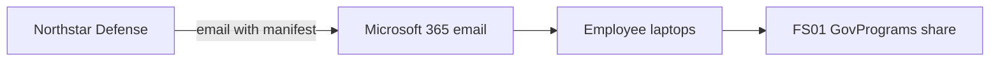

# System Security Plan (SSP) — Tidewell CUI Environment

> Practice document. Required by NIST SP 800-171 requirement 3.12.4 and requested by Northstar by February 1, 2027. Complete each section. Prompts in *italics* tell you what goes there.

| Field | Value |
| --- | --- |
| System name | Tidewell CUI Environment |
| Contract | Northstar Defense Services Subcontract NDS-2024-117 (DFARS 252.204-7012) |
| Security category | *From your FIPS 199 worksheet* |
| SSP version | 0.1 (draft) |
| Prepared by | Indrick Bodkin, GRC Analyst |
| Date | |

## 1. System description
*In 3–5 sentences, say what the system does, who uses it, and what CUI it handles. Write it so a Northstar reviewer who has never visited Tidewell understands.*

## 2. Roles
| Role | Name | Responsibility |
| --- | --- | --- |
| System Owner | | *Business leader accountable for the CUI work* |
| Information System Security Officer (ISSO) / security contact for Northstar | | *Northstar's letter, item 4, asks for this name* |
| System Administrator | | |
| Risk acceptance authority | | |
| GRC / compliance | Indrick Bodkin | Maintains the SSP and POA&M |

## 3. Authorization boundary (what's "inside" the system)
*List every place CUI is stored, processed, or sent. Use the interviews, the server and laptop inventories, the vendor list, and the share permissions. If CUI is somewhere it shouldn't be (for example, a personal account), list it anyway and mark it "unauthorized — see finding."*

| Component | Type | Holds/sends CUI? | Notes |
| --- | --- | --- | --- |
| FS01 (GovPrograms share) | Server | Yes | Windows Server 2012 R2 |
| | | | |
| | | | |

## 4. Data flow diagram
*This diagram uses Mermaid, which GitHub draws automatically. Add the missing arrows and boxes. Follow one manifest from the moment Northstar sends it to the moment it's deleted.*

## 5. Interconnections and outside services
*Which vendors or outside systems touch CUI? (Hint: vendor list, Bayside questionnaire.) For each, is there a contract that requires them to protect CUI?*

| Vendor / system | What it does | Touches CUI? | DFARS 7012 flowed down in contract? |
| --- | --- | --- | --- |
| | | | |

## 6. Requirement implementation statements
*For each NIST SP 800-171 requirement, say what Tidewell does **today** and whether it is Implemented, Partially implemented, or Not implemented. If it's not implemented, point to the POA&M item. Never describe a plan as if it's already done.*

| Req | Requirement (short) | Status | How Tidewell meets it today | POA&M |
| --- | --- | --- | --- | --- |
| 3.5.7 | Enforce minimum password complexity | Implemented (change planned) | Active Directory enforces policy IT-004: an 8-character minimum with upper case, lower case, number, and symbol. This meets the wording of 3.5.7, but it does not follow current NIST guidance (SP 800-63B-4), which favors length and a banned-password list over composition rules. Tidewell plans a 15-character minimum and a banned-password list (POAM-01) and will confirm with Northstar that the new approach satisfies 3.5.7. | POAM-01 |
| 3.1.1 | Limit system access to authorized users | | | |
| 3.1.2 | Limit users to the transactions and functions they're allowed | | | |
| 3.1.4 | Separate duties of individuals | | | |
| 3.1.5 | Least privilege, including for privileged accounts | | | |
| 3.1.19 | Encrypt CUI on mobile devices | | | |
| 3.1.20 | Control connections to external systems | | | |
| 3.2.1 / 3.2.2 | Security awareness and role-based training | | | |
| 3.3.1 | Create and keep audit logs | | | |
| 3.3.5 | Correlate and review audit logs | | | |
| 3.4.1 | Baseline configurations and inventories | | | |
| 3.5.3 | MFA for privileged accounts and network access | | | |
| 3.5.8 | Prohibit password reuse | | | |
| 3.6.1 | Incident handling capability | | | |
| 3.6.2 | Track, document, and report incidents | | | |
| 3.6.3 | Test the incident response capability | | | |
| 3.8.9 | Protect backups that contain CUI | | | |
| 3.9.2 | Protect CUI during and after personnel actions (terminations) | | | |
| 3.10.1 / 3.10.4 | Physical access and visitor logs | | | |
| 3.12.2 | Plans of action to fix deficiencies | | | |
| 3.12.4 | System Security Plan | | | |
| 3.13.1 | Monitor and protect the network boundary | | | |
| 3.13.16 | Protect CUI at rest | | | |
| 3.14.1 | Fix system flaws on time | | | |
| 3.14.2 | Malicious code protection | | | |

> **Lesson from the example row:** a control can meet the *wording* of a requirement and still be weak. "Compliant" and "secure" aren't the same thing. Say both in the SSP, honestly.

*Note: NIST SP 800-171 has 110 requirements. This draft covers the ones tested in this assessment. A complete SSP would address all 110.*

## 7. Approval
| Role | Name | Signature / date |
| --- | --- | --- |
| System Owner | | |
| Risk acceptance authority | | |
